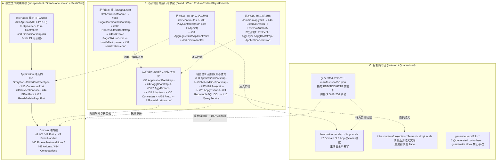

# `scala-cqrs-play-service@2` 完整验收标准规范（Acceptance Specification v2.0）

> **定位**：本文档是 `truthsrc` 代码生成器 `scala-cqrs-play-service@2` 的**唯一权威验收契约（North-Star Acceptance Specification）**。任何新增、重构、合并或发布动作，都必须以本规范中的**七大红线、三态边界分类（独立工作 / 必须粘合 / 强制隔离）、54 族 Artifact Type 验收矩阵、以及 G0–G6 分层门禁**作为准绳，防止目标漂移、生成“孤岛代码”或破坏强管控分层。

---

## 1. 七大不可违背的北极星红线（North-Star Invariants）

| 编号 | 红线名称 | 强制标准（Fail-Closed） | 违反后果 |
| :--- | :--- | :--- | :--- |
| **S1** | **严格超集不变式 (`V2 ⊇ V1`)** | 覆盖全部 **54 族 Artifact Type**（传统 MBT `#1–#39` + 扩展 `#40–#42` + 统一策展 `#43–#47` + 2.0 协同演进 `#48–#54`）；任何 1.0 已有族不得无说明缺失；旧机制族 `#16–#21` 必须有显式 `supersededBy` 替代映射。 | 验收直接拒绝 |
| **S2** | **三态边界清晰（独立 / 粘合 / 隔离）** | 每一族 Artifact 必须归属唯一职责边界：**独立可测内核**、**必须端到端粘合的运行时装配**、或**强制隔离区**。严禁生成无人引用、未挂载启动、未接入路由或未注册序列化的“孤岛文件”。 | 判定为假完成 |
| **S3** | **洋葱架构 DIP 与隔离区保护** | `domain/` 零框架依赖；`application/` 零 `play.`/`interfaces`/`infrastructure`/`modules` 依赖；`generated-scaffold/` 禁止人工修改；`handwritten/.../*Impl.scala` 仅允许 `@cloze` 槽位手写且生成器绝不覆盖；`generated-tests/` 经 `manifest.sha256.json` 锁定防篡改。 | `verify-v2` 熔断 |
| **S4** | **语义稳定溯源（Semantic `@knowledge`）** | 严禁任何数组下标指针（如 `/aggregates/2/commands/0/guards/2`）。全部锚点必须使用业务语义键（`/aggregates/<Agg>/commands/<Cmd>`、`/behaviors/<Slice>/rules/<RuleId>`、`/readModels/<Name>` 等），真源增删改序后锚点仍 100% 稳定。 | 溯源门禁失败 |
| **S5** | **真实语义而非空壳占位（Zero Stub Theater）** | 禁止出现 `???`；事件含非空字段时 `checkEventPostconditions` 必须生成真实运行时校验（不得退化为 `= None`）；禁止拼接转义 JSON 字符串（如 `contractJson = "{\"...\"}"`），强制强类型 `CallerContractSpec` 与 Scala `"""...""".stripMargin` 惯用语法。 | 代码审查/单测拒收 |
| **S6** | **零硬编码运行时 & 1.0 Parity 零退化** | 除 `lib/runtime-profile.mjs` 外禁止硬编码运行时组织/包名（`npm run lint:arch` 0 issues）；`node emitter/parity.mjs` 全部 24 族必须维持 `allGreen: true`。 | CI 阻断合并 |
| **S7** | **问题空间与解空间解耦（Context Mapping Gate）** | Subdomain（问题空间）绝不等价于 Bounded Context（解空间服务）。必须经 Phase 3.5 `domain-map.yaml`（或零配置 `--packaging monolith` 大泥球策略）确认后按 BC 生成；跨 BC 边界自动触发 `#46 ExternalEventBridge` + `ExternalAuthority`。 | 禁止直接发版 |
| **S8** | **EARS 双分支契约 & 0 方法才允许 `Noop`** | **分支一（确定性 4A）**：必须非空真实逻辑 + 100% 锁定测试覆盖（含 `checkEventPostconditions` 断言）+ 100% 变异杀死率，且仅 0 抽象方法的 ABI Trait 才允许 `Noop`。 **分支二（非确定性 4B & Infra）**：L2 领域算子（`<Agg>ComputationsImpl` + `<Target>Impl`）、L3 应用编排（`<Story>Impl`）、`#26 *ApplyEventSemanticsImpl`、`#25 *ConnectorImpl`、`#44 *EffectPortImpl` 必须默认生成于 `handwritten/scala/` 隔离区、严禁 `Noop`，且全部在 `GeneratedBindingsModule` + `HandwrittenBindingsModule` + `<Context>ProjectionModule` 完成 DI 绑定。 | `npm run test:acceptance-v2` 直接拒收 |

---

## 2. 三态架构拓扑：哪些独立工作、哪些必须粘合、哪些强制隔离

### 2.1 三态职责定义与验收红线

#### A. 独立工作（Independent — 零重型框架、毫秒级可测）
- **特征**：不依赖 Akka Cluster、Play Server、Guice、PostgreSQL 或外部网络；可由裸 `scalac` + `ScalaTest` 在数秒内完成编译、单元测试与领域变异测试。
- **验收要点**：
  1. **零外层污染**：`domain/` 禁止出现任何 `akka.` / `play.` / `javax.inject.` / `scalikejdbc.`；`interfaces/http/HttpRouter.scala` 与 `interfaces/api/ApiDto.scala` 保持纯 Scala 可直接执行 401/403/CSRF/IDOR/RowScope 全链路测试。
  2. **数学与变异双重收口**：L1 确定性规则由 Z3 证明互斥与完备，并由 Domain Mutation Gate 达到 **100% 变异杀死率**。

#### B. 必须粘起来（Glued / Wired — 6 条端到端装配契约，缺一即判失败）
> **核心原则**：生成文件本身**不构成交付**，只有被正确接入**启动引导、路由表、DI 容器、序列化注册与事件标签**才算交付！

| 粘合链编号 | 粘合链名称 | 必须闭合的引用关系（缺任何一环即判失败） |
| :--- | :--- | :--- |
| **GLUE-1** | **HTTP 入站与 `auth-core` 鉴权链** | `conf/routes (#37)` 必须挂载全部 `controllers.<Story>PlayController.*` (`#35`) 与 `controllers.AggregateStateApiController.*` (`#34`)；每个 PlayController 必须注入 `Endpoint` 并按 `authz` 映射到 `api.{tenant,global,anonymous}.{read,write}(roles*)`，返回 `OkReceipt`/`ApiError` (`#36`)，并委托给 `application.services.<Story>Handler`。 |
| **GLUE-2** | **写侧聚合启动与 Protobuf 持久化链** | `ApplicationBootstrap (#38)` 必须 `extends <Agg>Bootstrap (#47)` 并调用 `init<Agg>Aggregate(sharding, <agg>Computations[, <agg>Authority])`；`BootstrapModule` 绑定 `<Agg>Repository -> <Agg>RepositoryImpl (#12)`；`<Agg>EventAdapter` / `<Agg>SnapshotAdapter (#31)` 与 `<Agg>ProtoConverters (#30)` 对齐 `protobuf/<agg>.proto (#29)`；`DomainProtoSerializer` 注册于 `conf/serialization.conf (#39)`。 |
| **GLUE-3** | **读侧投影启动与查询链** | 对每个 `readModels[*]`：`ApplicationBootstrap (#38)` 必须混入 `with <View>ReadsideBootstrap (#38b)` 并调用 `init<View>ReadsideProjection(system, readJournalPluginId, tags, repository, bindings)`；`tags` 必须聚合写侧全部 `<Agg>Aggregate.tags`；若声明 `source: eventField:...`，必须同时发射 `#26 <View>ApplyEvent` + `<View>ApplyEventSemantics` + `<Context>ProjectionModule` 并在 `ProjectionHandler (#28)` 匹配对应事件；`#24 RepositoryImpl + Schema DDL` 必须实现 `#23 Repository Port` 并供 `#15 QueryService` 注入。 |
| **GLUE-4** | **Saga / Process / Effect 引擎启动与序列化链** | 凡存在显式 `sagas`/`effects` 或多步编排 `stories`：必须发射 `OrchestrationModule` 绑定 `SagaCoordinatorBootstrap (#38c)` 为 eager singleton；`SagaCoordinatorBootstrap` 必须混入全部 `<Flow>ProcessBootstrap` 与 `<Eff>EffectBootstrap (#38d)` 并逐一调用 `init*`；对应 `protobuf/<flow>_host.proto` 与 `<eff>_effect.proto` 必须与 `conf/serialization.conf (#39)` 中 `hosts` / `effects` 序列化绑定严格一致。 |
| **GLUE-5** | **跨 BC 防腐层与 `ExternalAuthority` 四处同步链** | 凡 `domain-map.yaml` 存在跨 BC 边或聚合声明 `externalProducers`：必须同时在 **4 处**同步开启权威契约——(1) `#46 <Agg>ExternalEvents.scala`、(2) `#7 <Agg>Protocol`（生成 `ExternalAuthority` + `Ingest*`）、(3) `#6 <Agg>Aggregate`/`Behaviors`（开启 `externalBehavior`）、(4) `#47 <Agg>Bootstrap` + `#38 ApplicationBootstrap`（`init<Agg>Aggregate(..., authority)`）。任意一处漏同步即编译断裂。 |
| **GLUE-6** | **构建与依赖装配链 (`build.sbt` + `project/*` + `conf/*`)** | `build.sbt` 必须同时挂载 `generated-scaffold/scala` + `handwritten/scala`（主源码）、`generated-scaffold/protobuf`（ScalaPB）、`generated-tests/scala`（测试源码），并声明 `PlayScala`、`common-core`、`akka-persistence-typed`、`akka-cluster-sharding-typed`、`akka-projection-eventsourced`、`akka-projection-slick`、`scalikejdbc`、`scalapb-runtime`、`scalatest`。 |

#### C. 强制隔离（Isolated — 权限边界、所有权边界、变更边界）
1. **生成区 vs 手写区物理隔离**：
   - `generated-scaffold/**` 归生成器 100% 所有（全量覆盖 + `// @generated by truthsrc scala-cqrs-play-service:2` + `// @canonical-v2 <sha>`），`guard-write` Hook 拦截人工编辑。
   - `handwritten/scala/<pkg>/domain/services/impl/<Target>Impl.scala`（L2）与 `handwritten/scala/<pkg>/application/services/<Story>Impl.scala`（L3）归人工/AI Cloze Worker 所有，生成器仅在文件不存在时初始化骨架，默认永不覆写；仅允许在 `// @cloze:start(<id>)` 与 `// @cloze:end(<id>)` 之间填写，严禁使用 `*Cloze.scala` 文件名。
   - `#26` 读侧语义实现 `<View>ApplyEventSemanticsImpl.scala` 归手写基础设施隔离区所有，生成器只发 `trait <View>ApplyEventSemantics` 面。
2. **测试预言机防篡改隔离**：
   - `generated-tests/**` 与 `generated-tests/manifest.sha256.json` 由 `emit-tests-v2` 生成并加锁；`verify-v2` 执行前先校验全部测试文件 SHA-256，任何一字节篡改直接熔断。
3. **双层验证运行时隔离**：
   - 纯内核层由 `SBT_FRAMEWORK_IMPORT_RE` 自动分离出独立集合，供裸 `scalac` + `ScalaTest` + Mutation Gate 高频执行；Play/Akka/ScalikeJDBC/`auth-core`/Saga 文件计入 `sbtRuntimeFilesCount`，交由 `sbt compile` / 集成测试门禁（G6）统一编译验证。

---

## 3. 全量 54 族 Artifact Type 逐族验收矩阵

> 分类符号：`[独立]` = 独立纯内核（裸 `scalac` 可直接编测）；`[粘合]` = 必须按 GLUE-1..6 接入运行链路；`[隔离]` = 所有权/防篡改受控边界。

### 3.1 Domain 写侧内核（8 族：`#1–#5, #11, #14, #45, #48`）

| 族号 | Artifact Type 族名 | 层级 | 三态分类 | 标准路径（相对 `generated-scaffold/` 或根目录） | 验收要点 |
| :--- | :--- | :--- | :--- | :--- | :--- |
| `#1` | `value-object` | Domain | `[独立]` | `scala/<pkg>/domain/values/<VO>.scala` | 经 1.0 `value-object.mjs` 生成；精确数值类型零浮点；语义 `@knowledge #/exactTypes/<Name>` 或 `#/valueObjects/<Name>`。 |
| `#2` | `domain-entity` | Domain | `[独立]` | `scala/<pkg>/domain/entities/<Agg>Entity.scala` | 经 1.0 `domain-entity.mjs` 生成；`State` + `sealed trait Event`；零框架依赖；语义 `@knowledge #/aggregates/<Agg>`。 |
| `#3` | `event-handler` | Domain | `[独立]` | `scala/<pkg>/domain/entities/behaviors/<Agg>EventHandler.scala` | 经 1.0 `event-handler.mjs` 生成；纯函数 `apply(state, event): State`；语义锚点 `#/aggregates/<Agg>/events/<Ev>/fold/<Field>`。 |
| `#4` | `invariant-rules` *(并入 `#45`)* | Domain | `[独立]` | `scala/<pkg>/domain/invariants/<Agg>Rules.scala` | 见 `#45`；无双重否定 `!( !(...) )`。 |
| `#5` | `invariant-rule-params` *(并入 `#45`)* | Domain | `[独立]` | `scala/<pkg>/domain/invariants/params/<Agg>RuleParams.scala` | 见 `#45`；L2 混合场景自动产出 `<Agg>DomainServiceRuleParams.scala` 无冲突。 |
| `#11` | `aggregate-rules-formal` *(由 `#45` 统一)* | Domain | `[独立]` | `scala/<pkg>/domain/invariants/<Agg>Rules.scala` | 1.0 黄金 Parity 保持 `allGreen`；v2 由 `#45` 统一发射。 |
| `#14` | `domain-computations` *(由 `#7` + Block A 协同)* | Domain | `[独立]` | `scala/<pkg>/domain/services/<Agg>Computations.scala` | 纯 `DomainService` Trait + `Noop` 伴生对象，供单测零 Mock 注入。 |
| `#45` | `aggregate-invariant-rules` | Domain | `[独立]` + `[粘合]` | `scala/<pkg>/domain/invariants/<Agg>Rules.scala` + `params/*RuleParams.scala` | 经 1.0 `aggregate-invariant-rules.mjs` 生成；语义锚点 `#/behaviors/<Target>/rules/<RuleId>`；**非空事件字段必须生成真实 `checkEventPostconditions`**；Mutation Gate 100% 杀死。 |
| `#48` | `aggregate-axioms` *(v2 新增)* | Domain | `[独立]` | `scala/<pkg>/domain/entities/<Agg>Axioms.scala` | 提供纯 `replay(initial, events)` + Z3 验证的 `checkAxioms(state)`，被全部 Domain 锁定测试调用。 |

### 3.2 Aggregate Akka EventSourced 运行时层（6 族：`#6–#10, #12, #22, #47`）

| 族号 | Artifact Type 族名 | 层级 | 三态分类 | 标准路径 | 验收要点 |
| :--- | :--- | :--- | :--- | :--- | :--- |
| `#6` | `aggregate-layer` *(合 `#8,#9,#10`)* | Domain/App | `[粘合]` | `domain/<Agg>Aggregate.scala`, `application/aggregates/<Agg>Aggregate.scala`, `factories/<Agg>AggregateFactory.scala`, `behaviors/<Agg>Behaviors.scala` | 经 1.0 `aggregate-layer.mjs` 生成；GLUE-2 绑定 `#45` Rules 与 `#3` EventHandler；有 `#46` 时自动启用 `ExternalAuthority`（GLUE-5）。 |
| `#7` | `protocol-layer` *(合 `#14`)* | App | `[粘合]` | `application/aggregates/<Agg>Protocol.scala`, `behaviors/<Agg>CommandHelpers.scala` | 经 1.0 `protocol-layer.mjs` 生成；声明命令协议与 `Get<Base>State`/`Reply`；有 `#46` 时生成 `ExternalAuthority` & `Ingest*`。 |
| `#8` | `aggregate-factory` *(并入 `#6`)* | App | `[粘合]` | `application/aggregates/factories/<Agg>AggregateFactory.scala` | 由 `#6` 统一发射。 |
| `#9` | `aggregate-behaviors` *(并入 `#6`)* | App | `[粘合]` | `application/aggregates/behaviors/<Agg>Behaviors.scala` | 由 `#6` 统一发射，调用 `checkEventPostconditions`。 |
| `#10` | `aggregate-command-helpers` *(并入 `#7`)* | App | `[粘合]` | `application/aggregates/behaviors/<Agg>CommandHelpers.scala` | 由 `#7` 统一发射。 |
| `#12` | `aggregate-repository` *(合 `#22`)* | App/Infra | `[粘合]` | `application/aggregates/repository/<Agg>Repository.scala`, `infrastructure/repositories/aggregate/<Agg>RepositoryImpl.scala` | 经 1.0 `aggregate-repository.mjs` 生成；在 `BootstrapModule` 中绑定接口到实现（GLUE-2）。 |
| `#22` | `aggregate-repository-impl` *(并入 `#12`)* | Infra | `[粘合]` | `infrastructure/repositories/aggregate/<Agg>RepositoryImpl.scala` | 由 `#12` 统一发射，接入 ClusterSharding。 |
| `#47` | `aggregate-bootstrap` | Infra | `[粘合]` | `infrastructure/bootstrap/<Agg>Bootstrap.scala` | 经 1.0 `aggregate-bootstrap.mjs` 生成；被 `ApplicationBootstrap` 混入并调用 `init<Agg>Aggregate`（GLUE-2/5）。 |

### 3.3 ReadSide / CQRS 投影与查询层（7 族：`#15, #23, #24, #26, #27, #28` + `#38b`）

| 族号 | Artifact Type 族名 | 层级 | 三态分类 | 标准路径 | 验收要点 |
| :--- | :--- | :--- | :--- | :--- | :--- |
| `#15` | `query-service` | App | `[粘合]` | `application/readmodels/<view_snake>/<View>QueryService.scala` | `@Singleton` 注入 `#23` Repository，提供分页与主键查询（GLUE-3）。 |
| `#23` | `projection-repository-port` | App | `[独立]` | `application/readmodels/<view_snake>/<View>View.scala` + `repository/<View>ReadsideRepository.scala` | 继承 `ReadModel`；纯异步接口，无 SQL/框架泄露。 |
| `#24` | `projection-repository-implementation` | Infra | `[粘合]` | `infrastructure/repositories/projection/<View>ReadsideRepositoryImpl.scala` + `<View>ReadsideSchema.scala` | 实现 `#23` Port；**SQL DDL 与 Upsert 必须使用 Scala `"""...""".stripMargin` 惯用语法**，零转义拼接。 |
| `#26` | `projection-apply-event` | App/Infra | `[粘合]` + `[隔离]` | `application/projection/handlers/<View>ApplyEvent.scala`, `*ApplyEventSemantics.scala`, `application/projection/repository/<Stem>Table.scala`, `infrastructure/bootstrap/<Ctx>ProjectionModule.scala` | 当 `readModels` 声明 `source: eventField:...` 时调用真实 1.0 `projection-apply-event.mjs`；仅发 Semantics Face，Impl 保留在手写隔离区。 |
| `#27` | `projection` | App | `[粘合]` | `application/readmodels/<view_snake>/<View>ReadsideProjection.scala` | 定义 `ProjectionName`、`EventSourcedProvider.eventsByTag` 与 Handler 构造器（GLUE-3）。 |
| `#28` | `projection-handler` | App | `[粘合]` | `application/readmodels/<view_snake>/<View>ReadsideProjectionHandler.scala` | 含 `object Bindings` 契约，匹配对应聚合领域事件并写入 `#23` Repository（GLUE-3）。 |
| `#38b` | `readside-bootstrap` *(挂入 `#38`)* | Infra | `[粘合]` | `infrastructure/bootstrap/<View>ReadsideBootstrap.scala` | 由 `ApplicationBootstrap` 混入 `with <View>ReadsideBootstrap` 并执行 `init<View>ReadsideProjection(...)`（GLUE-3）。 |

### 3.4 编排、Saga、Effect Host、ToolGate 与跨 BC 防腐层（14 族：`#13, #16–#21, #25, #40–#44, #46` + `#38c/#38d`）

| 族号 | Artifact Type 族名 | 层级 | 三态分类 | 标准路径 | 验收要点 |
| :--- | :--- | :--- | :--- | :--- | :--- |
| `#13` | `external-connector-port` | App | `[独立]` | `application/toolgates/<Port>ConnectorPort.scala` | 从 `externContracts` 分组派生的纯业务连接器端口，零框架泄露。 |
| `#25` | `connector-implementation` | Infra | `[粘合]` | `infrastructure/connectors/<Port>ConnectorImpl.scala` | `@Singleton` 实现 `#13` Port，负责外联适配。 |
| `#16–#21` | `legacy-saga/process-manager` *(已被 `#40–#44 + #38c/#38d` 取代)* | App/Infra | `[粘合]` | 见 `generator.json` `supersededLegacyFamilies` | **显式废弃映射**：`#16->#40+#42`, `#17->#40+#43`, `#18->#42+#38c`, `#19->#43+#44`, `#20->#42+#38d`, `#21->#41+#38c`。 |
| `#40` | `strict-saga-module` | App | `[粘合]` | `application/process/<Flow>SagaModule.scala` | 继承 `StrictDurable`，定义有序步骤、SagaEvent 与纯状态折叠。 |
| `#41` | `strict-fixture-host` | App | `[独立]` | `application/process/<Flow>FixtureHost.scala` | 确定性 Saga 重放与待执行步骤夹具，支持无集群单测。 |
| `#42` | `composition-invocation-host` | App | `[粘合]` | `application/process/<Flow>CompositionHost.scala` + `protobuf/<flow>_host.proto` | Akka ClusterSharding 托管实体（`TypeKey`）+ Host Protobuf + 注册于 `conf/serialization.conf` `hosts`（GLUE-4）。 |
| `#43` | `pipeline-invocation-face` | App | `[独立]` | `application/process/<Flow>InvocationFace.scala` | 纯调用门面（`StartRequest` / `ExecutionResult` / `Client`）。 |
| `#44` | `effect-face` | App | `[独立]` + `[粘合]` | `application/process/<Eff>EffectFace.scala` + `protobuf/<eff>_effect.proto` | 声明外部副作用协议（如 `three-phase-reconcile` / `idempotent-pin`）与 `EffectEvent` + 注册于 `conf/serialization.conf` `effects`（GLUE-4）。 |
| `#46` | `external-event-bridge` | App | `[粘合]` | `application/aggregates/behaviors/<Agg>ExternalEvents.scala` | 调用真实 1.0 `external-event-bridge.mjs`；由 `domain-map.yaml` 跨 BC 边或 `externalProducers` 触发，严格满足 GLUE-5 四处同步。 |
| `#38c/#38d` | `saga-coordinator-bootstrap` + `process/effect-bootstrap` | Infra | `[粘合]` | `infrastructure/bootstrap/SagaCoordinatorBootstrap.scala`, `<Flow>ProcessBootstrap.scala`, `<Eff>EffectBootstrap.scala`, `modules/OrchestrationModule.scala` | `OrchestrationModule` 绑定 `SagaCoordinatorBootstrap` 为 eager singleton，启动全部 Saga/Effect 引擎（GLUE-4）。 |

### 3.5 Protobuf、转换器与序列化层（5 族：`#29–#33`）

| 族号 | Artifact Type 族名 | 层级 | 三态分类 | 标准路径 | 验收要点 |
| :--- | :--- | :--- | :--- | :--- | :--- |
| `#29` | `proto-schema` | Infra | `[粘合]` | `protobuf/shared_value_objects.proto`, `protobuf/<agg>.proto` (+ `*_host.proto`, `*_effect.proto`) | 经 1.0 `proto-schema.mjs` 生成；完整覆盖精确类型、值对象、聚合状态与 `oneof` 事件联合体（GLUE-2）。 |
| `#30` | `proto-converter` | Infra | `[粘合]` | `infrastructure/persistence/converters/{SharedValueProtoConverters, <Agg>ProtoConverters, DomainConverters}.scala` | 经 1.0 `proto-converter.mjs` 生成；双向无损转换（GLUE-2）。 |
| `#31–#33` | `serialization-adapter` *(合 `#32 EventAdapter`, `#33 SnapshotAdapter`)* | Infra | `[粘合]` | `infrastructure/persistence/{DomainProtoSerializer, <Agg>EventAdapter, <Agg>SnapshotAdapter}.scala` | 经 1.0 `serialization-adapter.mjs` 生成；注册于 `conf/serialization.conf`（GLUE-2）。 |

### 3.6 HTTP API、`auth-core` 控制器、Play 运行时与工程脚手架（6 族：`#34–#39`）

| 族号 | Artifact Type 族名 | 层级 | 三态分类 | 标准路径 | 验收要点 |
| :--- | :--- | :--- | :--- | :--- | :--- |
| `#34` | `aggregate-state-controller` | Interfaces (Play) | `[粘合]` | `scala/controllers/AggregateStateApiController.scala` | 经真实 1.0 `aggregate-state-controller.mjs` 生成；使用 `auth-core` `Endpoint`；已挂载至 `conf/routes`（GLUE-1）。 |
| `#35` | `http-controller` | Interfaces (Play) | `[粘合]` | `scala/controllers/<Story>PlayController.scala` | 注入 `Endpoint`（`auth-core`），按 `authz` 精确发射 `api.{tenant,global,anonymous}.{read,write}(roles*)`，委托 `<Story>Handler`（GLUE-1）。 |
| `#36` | `command-endpoint-dsl` | Infra | `[粘合]` | `scala/<pkg>/infrastructure/api/CommandDsl.scala` | 提供 `OkReceipt`、`ViewItem`、`ViewListDto`、`IdGuard`、`InstantGuard`（经 `runtime-profile` 派生 `commonPackage`）。 |
| `#37` | `routes` | Conf | `[粘合]` | `conf/routes` | 统一挂载 `/health`、全部 `#35 PlayController` 与 `#34 AggregateStateApiController` 路由（GLUE-1）。 |
| `#38` | `service-runtime` | Infra/Modules | `[粘合]` | `infrastructure/bootstrap/{<Svc>Contract, <Svc>Loader, <Svc>Configuration, ApplicationBootstrap}.scala`, `modules/BootstrapModule.scala`, `conf/{application,cluster,persistence,logback}.conf` | 经真实 1.0 `service-runtime.mjs` 生成；`ApplicationBootstrap` **必须显式混入并初始化全部写侧 Aggregate 与读侧 ReadsideProjection**（GLUE-2/3/5）。 |
| `#39` | `project-scaffold` | Build/Conf | `[粘合]` | `conf/serialization.conf`, `build.sbt`, `project/{build.properties,plugins.sbt}` | 经真实 1.0 `project-scaffold.mjs` 生成；`serialization.conf` 同时注册 `domainProto0`、`strict-saga`、`hosts`、`effects`（GLUE-2/4/6）。 |

### 3.7 co-arising 2.0 协同演进增强族（6 族：`#49–#54`；含 `#48` 共 7 族）

| 族号 | Artifact Type 族名 | 层级 | 三态分类 | 标准路径 | 验收要点 |
| :--- | :--- | :--- | :--- | :--- | :--- |
| `#49` | `authz-pep-dsl` | Interfaces | `[独立]` + `[粘合]` | `interfaces/api/ApiDto.scala`, `interfaces/http/{<Story>Controller, HttpRouter}.scala`, `interfaces/web/PlayHttpBridge.scala`, `application/connectors/OutboundConnectors.scala`, `infrastructure/{persistence/InMemoryStore, connectors/DefaultOutboundConnectors}.scala` | 完整 5 层 Authz PEP/PDP（401/403 RBAC、CSRF、IDOR、bindPrincipal、Entitlement、RowScope、External PDP），纯 Scala 毫秒级可测并与 `#35` 共享同一 `authz:` 真源。 |
| `#50` | `onion-bootstrap` | Modules | `[独立]` | `modules/OnionBootstrap.scala` | 纯 Scala DI 组合根，与 Play Guice `BootstrapModule` 和平共存零覆盖。 |
| `#51` | `application-port-and-caller-contract` | App | `[独立]` | `application/services/{<Story>Port, CallerContractSpec}.scala` | 强类型 `CallerContractSpec` 取代转义 JSON `contractJson`；提供 `<Story>Request / ExternPorts / EffectsPort / SuccessResponse / Handler`。 |
| `#52` | `cloze-impl-isolation` | Handwritten | `[隔离]` | `handwritten/scala/<pkg>/{domain/services/impl/<Target>Impl, application/services/<Story>Impl}.scala` | 严禁 `*Cloze.scala` 命名；仅在 `@cloze:start..end` 填写；`generate-v2` 默认绝不覆盖；支持 `tasks-v2` 队列追踪。 |
| `#53` | `locked-bdd-tdd-oracles` | Tests | `[隔离]` | `generated-tests/{features/*.feature, scala/.../*EarsSpec.scala, scala/.../InterfacesHttpSpec.scala, manifest.sha256.json}` | Z3 边界证人 + DMN First-Hit 锁定用例 + HTTP/Authz 锁定测试；SHA-256 防篡改锁定。 |
| `#54` | `mutation-gate-and-explorer-provenance` | Verify/View | `[隔离]` + `[粘合]` | `verify-v2 --strict --mutation-gate`, `view-v2 -> workshop.html`, `explorer snapshot` | Domain 变异测试 100% 杀死率；Explorer/Workshop 双向点行反查覆盖语义 `@knowledge`、`@ProvenanceId`、`@CoArisingSpec` 与 `@cloze`。 |

---

## 4. 分层验收门禁金字塔（G0–G6 可执行清单）

> 任何 PR、里程碑或对外发布，必须按顺序通过 **G0 → G6**，不得跳级宣称完成。

| 门禁 | 名称 | 执行命令 / 检查机制 | 通过判定标准（Hard Pass Criteria） |
| :--- | :--- | :--- | :--- |
| **G0** | **真源与上下文映射门禁** | `truthsrc compile-v2 --strict-lineage` + Phase 3.5 `domain-map.yaml` 评审 | Z3/SMT 0 gap/conflict/dead-rule；`domain-map.yaml` 明确 `boundedContexts` 与跨 BC `integrations` 模式。 |
| **G1** | **54 族超集与代码品质门禁** | `node --test test/v2-v1-strict-bridge.test.mjs` | 1. 全部生成文件带 `scala-cqrs-play-service:2` 头； 2. 零数字下标 `@knowledge`（正则 `/aggregates/\d+/` 0 命中）； 3. 零 `contractJson`； 4. 真实 `checkEventPostconditions`（非 `= None`）； 5. 多行 SQL/文本采用 `"""...""".stripMargin`。 |
| **G2** | **六大粘合链闭环门禁（Glue Audit）** | 自动化测试 + 静态交叉检查 | GLUE-1..6 全部闭环：`conf/routes` 路由可达控制器方法、`ApplicationBootstrap` 挂载全部聚合与 ReadSide、`SagaCoordinatorBootstrap` 挂载全部 Saga/Effect、`conf/serialization.conf` 注册全部 `domain`/`hosts`/`effects`、`ExternalAuthority` 四处同步。 |
| **G3** | **洋葱 DIP、防篡改与架构 Lint 门禁** | `truthsrc verify-v2 --strict` + `npm run lint:arch` | `onionCheck.passed === true` (0 违规)；`testabilityCheck.passed === true`；`manifestCheck.passed === true`；`lint:arch` 0 issues（零硬编码运行时）。 |
| **G4** | **独立内核编译、锁定测试与变异门禁** | `truthsrc verify-v2 --strict --mutation-gate` | 裸 `scalac` 0 错；Domain + Application + Interfaces HTTP/Authz `ScalaTest` 100% 通过；**Domain Mutation Gate `killRate === 100%`**；`sbtRuntimeFilesCount` 精确报告。 |
| **G5** | **1.0 黄金回归零退化门禁** | `node emitter/parity.mjs` | **24/24 families `allGreen: true`**，零黄金字节回归。 |
| **G6** | **完整 sbt/Play 运行时与溯源展示门禁** | CI `sbt compile`（含 ScalaPB + `auth-core` + `akka-projection` + `scalikejdbc`）+ `view-v2` + Explorer snapshot 校验 | `sbt compile` 全量 0 错；Play Guice 启动无缺绑定异常；Workshop HTML & Explorer snapshot 100% 节点命中 + `check-site.py` / `check-public-payloads.py` 全绿。 |

---

## 5. 防跑偏反模式红榜（Anti-Patterns — 出现即立即纠偏）

1. **孤岛文件反模式（Island Codegen）**：生成了 `ReadsideProjection` / `SagaModule` / `PlayController`，但未接入 `ApplicationBootstrap`、`SagaCoordinatorBootstrap`、`conf/routes` 或 `conf/serialization.conf`。→ **被 GLUE-1..5 门禁拦截**。
2. **盲目 1 Subdomain = 1 服务反模式**：跳过 `domain-map.yaml` 上下文映射决策，把每个子域直接生成独立微服务，制造分布式单体与无防腐层耦合。→ **被 Phase 3.5 Gate + `generate-v2 --domain-map --bc` 拦截**。
3. **洋葱击穿反模式**：在 `domain/` 引入 `akka.`/`play.`，或在 `application/` 引入 `infrastructure.`/`interfaces.`，导致纯领域内核丧失毫秒级独立验证能力。→ **被 G3 `onionCheck` 拦截**。
4. **脆弱下标溯源反模式**：使用 `/aggregates/2/commands/0/guards/2` 位置下标，一旦真源新增或重排元素，历史审计与 Explorer 高亮全部错位失效。→ **被 G1 语义锚点正则断言拦截**。
5. **空壳占位与劣质字符串反模式**：生成 `checkEventPostconditions = None`、`???` 或转义 JSON `val contractJson = "{\"...\"}"`。→ **被 G1 代码品质断言拦截**。
6. **假绿测试反模式**：允许 AI 修改 `generated-tests/` 或跳过 `--mutation-gate`，让弱断言掩盖真实守卫漏洞。→ **被 G3 `manifestCheck` + G4 100% Mutation Gate 拦截**。
7. **手写与生成混写反模式**：在 `generated-scaffold/` 手改逻辑，或在重新 `generate-v2` 时覆写 `handwritten/.../*Impl.scala`。→ **被 `guard-write` Hook 与隔离区不覆写策略拦截**。

---

## 6. 日常迭代与发布验收速查表

- **改了 `emitter/` 或 `lib/v2/bridge/`**：必须依次通过 **G1 + G2 + G3 + G4 + G5**。
- **改了业务真源（`truth/` 或 `domain-map.yaml`）**：必须依次通过 **G0 → G3 → G4 → G6（刷新 Workshop/Explorer）**。
- **改了 `handwritten/.../*Impl.scala`**：仅修改 `@cloze:start..end`，必须通过 **G3 + G4（含 100% Mutation Gate）** 并完成盲审记录（`tasks-v2 --record-review`）。
- **准备发版或接入外部真实 `sbt` 仓库**：必须额外通过 **G6（真实 `sbt compile` + `GuiceApplicationBuilder` 启动冒烟测试）**，验证所有 `sbtRuntimeFiles` 在真实 Play + Akka + ScalaPB + `auth-core` 依赖树下的端到端可编译性与可启动性。
